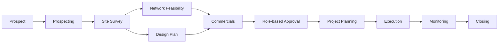
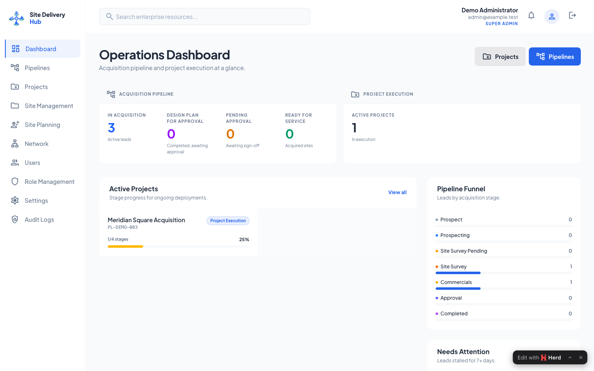
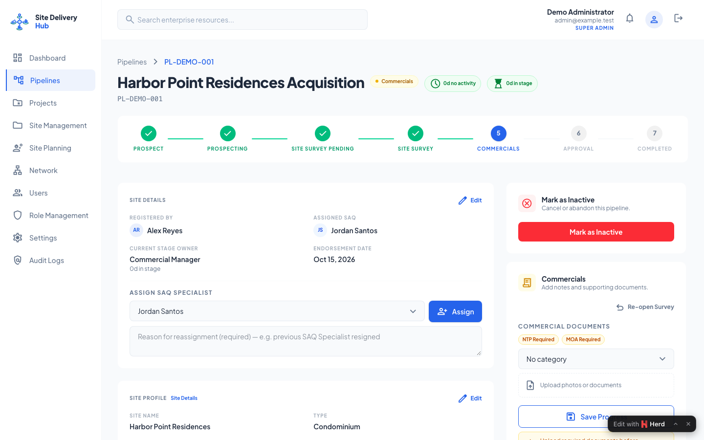
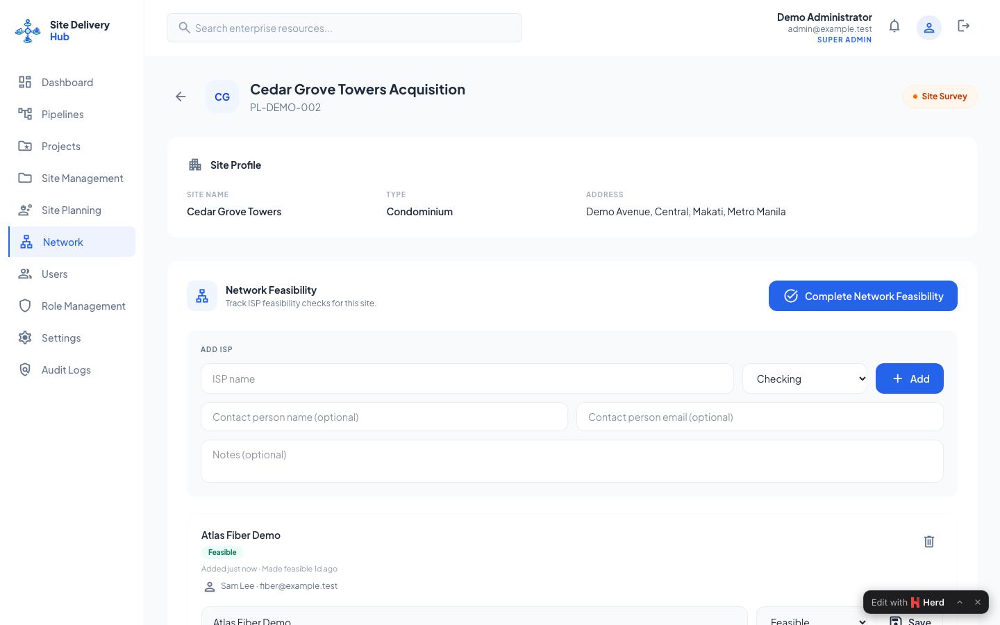
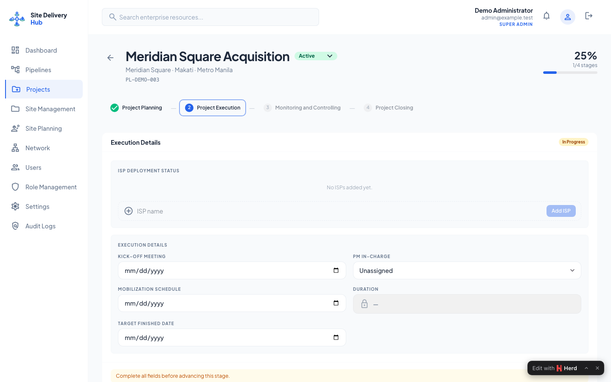
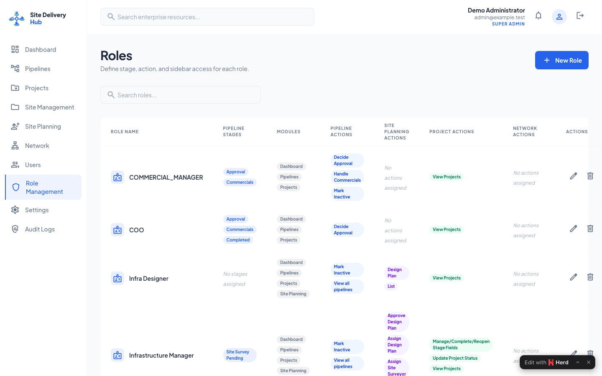

# Site Delivery Hub

**Site Acquisition CRM & Project Operations**

Site Delivery Hub is a portfolio application that carries site opportunities from acquisition through survey, network feasibility, commercials, approvals, and controlled project delivery. It demonstrates a role-aware operational workflow rather than a generic CRUD dashboard.

## Highlights

- Acquisition pipeline with gated status transitions and complete activity history
- Site survey scheduling, inspection capture, design planning, and tower-aware records
- Network feasibility tracking with ISP-specific tasks and documents
- Configurable, role-based commercial approval chain
- Four-stage project delivery workflow: Planning, Execution, Monitoring, and Closing
- Fine-grained module, status, action, and project-stage permissions
- Document requirements, versioning, notifications, audit logs, and operational dashboards
- CSV/XLSX pipeline import with validation and duplicate protection

## Workflow



The backend owns authorization, validation, and state transitions. Inertia delivers stable page-prop contracts to Vue, while domain models and support classes coordinate documents, notifications, activity, and project initialization. See [Architecture and workflow](docs/architecture.md) and the [database ERD](docs/database-erd.md).

## Screenshots

| Dashboard | Pipeline detail |
| --- | --- |
|  |  |

| Network feasibility | Project stage |
| --- | --- |
|  |  |



All screenshots use fictional portfolio data and `example.test` identities.

## Technology

- PHP 8.4 and Laravel 13
- Inertia.js 3 and Vue 3
- Tailwind CSS 4 and Vite 8
- MySQL in local/deployed environments; SQLite in automated tests
- Pest 4, Laravel Pint, ESLint, Vitest, Vue Test Utils, and jsdom
- GitHub Actions, Dependabot, dependency review, security audits, and CodeQL

## Engineering decisions

- Status changes pass through policies and dedicated request validation instead of trusting client state.
- Permissions combine module access, pipeline actions, visible statuses, and project-stage ownership.
- Documents are reusable records attached through explicit pivots so approved commercial files can carry into delivery without duplicating storage.
- Notifications are queued. Uploads, imports, audit logging, and workflow transitions remain synchronous so validation failures are immediately visible.
- Demo identities are isolated to `local` and `testing`; production environments cannot run the demo account seeder.

## Local setup

Requirements: PHP 8.4+, Composer, Node.js 22+, npm, and MySQL.

```bash
composer install
npm ci
cp .env.example .env
php artisan key:generate
```

Configure the MySQL connection in `.env`, then prepare the application:

```bash
php artisan migrate --seed
npm run build
```

Laravel Herd serves the project automatically when the directory is parked. For other environments, use the normal Laravel development workflow. Run a queue worker when testing queued notifications:

```bash
php artisan queue:work
```

## Demo accounts

The local/demo-only password is `DemoOnly123!`. It is intentionally shared for portfolio review and is unsafe for any deployed environment.

| Account | Role |
| --- | --- |
| `admin@example.test` | Super Admin |
| `lead.saq@example.test` | Lead SAQ Specialist |
| `saq@example.test` | SAQ Specialist |
| `infrastructure.manager@example.test` | Infrastructure Manager |
| `infrastructure.specialist@example.test` | Infrastructure Specialist |
| `designer@example.test` | Infra Designer |
| `surveyor@example.test` | Surveyor |
| `network.surveyor@example.test` | Network Surveyor |
| `network.manager@example.test` | Network Manager |
| `network.specialist@example.test` | Network Specialist |
| `commercial.manager@example.test` | Commercial Manager |
| `coo@example.test` | COO |

`DemoUserSeeder` exits without writing outside `local` and `testing` environments.

## Quality checks

```bash
composer validate --strict
php artisan test --compact
vendor/bin/pint --test
npm run lint
npm run test:unit
npm run build
```

The GitHub workflows run the same checks and add pull-request dependency review, weekly dependency updates, scheduled Composer/npm audits, and CodeQL analysis for JavaScript and workflow files.

## Known limitations

- This repository is a portfolio code sample, not a hosted public demo.
- Email delivery, cloud storage, and queues require environment-specific credentials.
- Uploads and imports run synchronously and should move to background jobs for high-volume deployments.
- CodeQL does not directly analyze PHP; PHP coverage relies on Composer auditing, Pest, Pint, request validation, and framework conventions.

Before making the repository public, enable GitHub secret scanning, push protection, Dependabot alerts, and branch protection requiring the CI checks.

## Source availability

Copyright © 2026 Mayan Anjoplasabas. Source is provided for portfolio review only. **No reuse license is granted**, and no `LICENSE` file is included.
