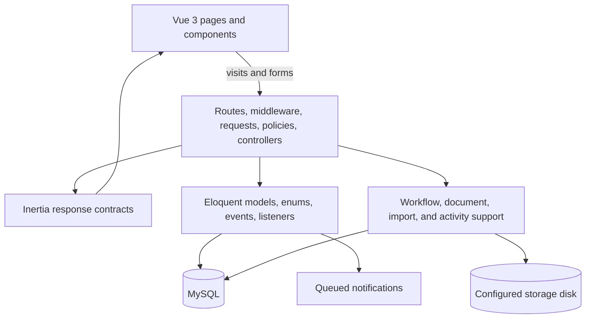

# Architecture and workflow

Site Delivery Hub uses a Laravel monolith with an Inertia/Vue client. HTTP boundaries own authorization and request validation; models and focused support classes own reusable workflow behavior.

## Acquisition to delivery

1. A Lead SAQ user records a prospect and assigns an SAQ specialist.
2. Prospecting collects site details and required documents.
3. Infrastructure schedules the survey; survey and design work are tracked separately.
4. Network users assess ISP feasibility while the design plan progresses.
5. Commercial terms and required documents enter a configurable approval chain.
6. Final approval initializes a project and carries eligible records into delivery.
7. Planning, Execution, Monitoring, and Closing advance sequentially with department-owned fields and document gates.

## Boundary rules

- Routes retain stable URIs and names because navigation, tests, and notification links depend on them.
- Policies recheck relationships at every write boundary; route model binding alone is not treated as ownership.
- Request objects validate user input before controllers coordinate workflow changes.
- Enums define pipeline statuses, project stages, modules, and action permissions.
- Activity and remark logs preserve who changed a record and why.
- File URLs are generated by the configured storage disk rather than a hardcoded host.

## Asynchronous work

Notifications implement Laravel's queued delivery contract. Uploads, imports, audit logging, and workflow transitions are synchronous. This keeps the current implementation straightforward while leaving clear queue candidates for higher-volume operation.
