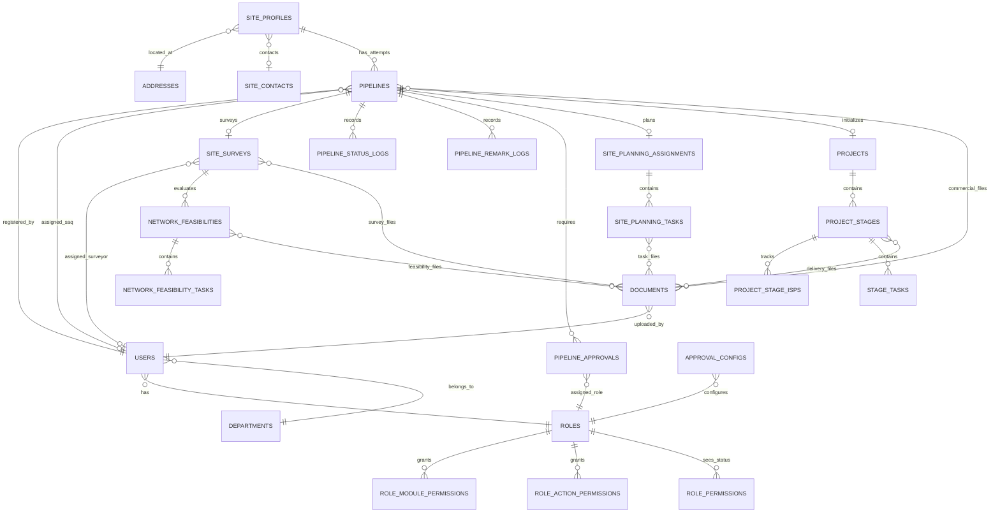

# Database ERD

This portfolio-safe overview focuses on the principal domain relationships. Laravel framework tables and lower-level document pivots are omitted for readability.

## Design notes

- A site profile is the durable location; a pipeline represents an acquisition attempt.
- Approval configuration is role-based so staff changes do not rewrite the workflow.
- Project stages are fixed and sequential, while task and document records carry execution detail.
- Documents can be referenced by more than one workflow context. Orphan checks prevent deletion while another domain record still uses a file.
- Several legacy relationships are enforced by application policies and Eloquent rather than database foreign keys; boundary tests cover those ownership rules.
